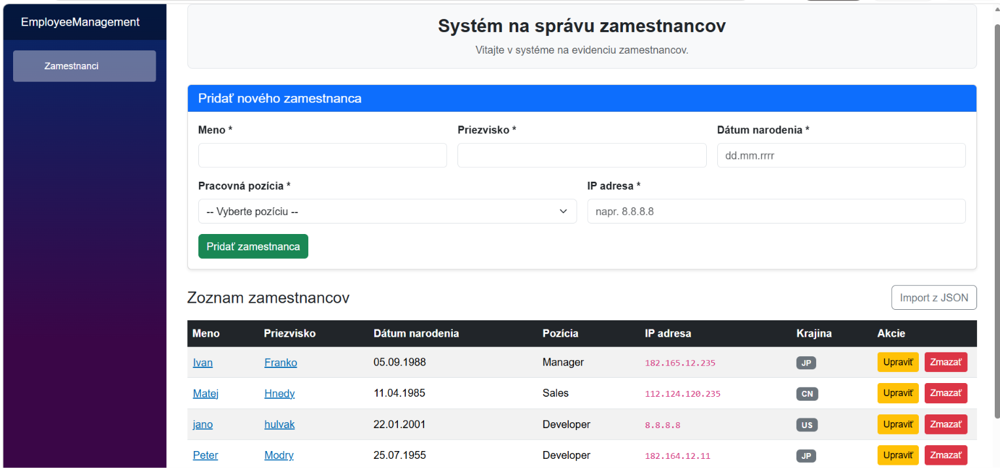

# Evidencia zamestnancov

Jednoduchá webová aplikácia na evidenciu zamestnancov. Je napísaná v **Blazor WebAssembly** (.NET 10) a dáta ukladá do **MS SQL** cez **Entity Framework Core** (Code First).



## Čo aplikácia vie

- zobraziť, pridať, upraviť a zmazať zamestnanca,
- pri pridávaní skontrolovať povinné polia a duplicitu (meno + priezvisko + dátum narodenia),
- po odoslaní formulára zistiť kód krajiny z IP adresy cez externé API ([ipwho.is](https://ipwho.is)),
- zobraziť detail zamestnanca v okne po kliknutí na meno alebo priezvisko,
- importovať pozície a zamestnancov z JSON súborov,
- zapisovať chyby do log súboru (Serilog).

## Požiadavky

- [.NET 10 SDK](https://dotnet.microsoft.com/download)
- SQL Server LocalDB (inštaluje sa spolu s Visual Studiom) alebo iná inštancia MS SQL
- internetové pripojenie (kvôli zisteniu krajiny z IP adresy)
- Visual Studio 2026 (nepovinné, aplikáciu možno spustiť aj z príkazového riadka)

## Spustenie

### 1. Nastavenie pripojenia k databáze

Connection string je v súbore `EmployeeManagement/appsettings.json` v časti `ConnectionStrings`. Predvolene sa používa LocalDB:

```
Server=(localdb)\MSSQLLocalDB;Database=EmployeeManagementDb;Trusted_Connection=True;TrustServerCertificate=True;
```

Ak používate inú inštanciu SQL Servera, upravte ho.

### 2. Vytvorenie databázy

Databáza sa vytvára z migrácií (Code First).

**Z príkazového riadka** (v priečinku serverového projektu, kde je `EmployeeManagement.csproj`):

```
dotnet tool install --global dotnet-ef
dotnet ef database update
```

Príkaz `dotnet tool install` stačí spustiť iba raz.

**Alebo vo Visual Studiu:** otvorte *Tools → NuGet Package Manager → Package Manager Console*, vyberte *Default project* `EmployeeManagement` (serverový projekt) a spustite:

```
Update-Database
```

Ak konzola skončí upozornením NU1903, použite príkazový riadok vyššie.

### 3. Spustenie aplikácie

**Vo Visual Studiu:** nastavte `EmployeeManagement` (serverový projekt) ako štartovací a stlačte **Ctrl+F5**.

**Z príkazového riadka** (v priečinku serverového projektu):

```
dotnet run --launch-profile https
```

Aplikácia sa otvorí v prehliadači na adrese uvedenej vo výpise (napríklad `https://localhost:7107`).

## Prvé kroky v aplikácii

Po prvom spustení je databáza prázdna, preto:

1. Kliknite na **Import z JSON**.
2. Pri **Pozície** vyberte `postions.json` a stlačte **Nahrať**.
3. Pri **Zamestnanci** vyberte `employes.json` a stlačte **Nahrať**.

Poradie je dôležité: zamestnanci sa nahrávajú až po pozíciách, aby sa dala pozícia priradiť podľa názvu. Ak sa pozícia nenájde, zamestnanec sa uloží bez pozície.

Import je možné spustiť opakovane. Pozície a zamestnanci, ktorí už existujú, sa preskočia.

Dátum narodenia sa v importe zadáva vo formáte `RRRR/MM/DD`, vo formulári na stránke ako `dd.mm.rrrr`.

## Konfigurácia

Všetky nastavenia sú v `EmployeeManagement/appsettings.json`:

| Kľúč | Význam |
|---|---|
| `ConnectionStrings:DefaultConnection` | pripojenie k databáze |
| `IpApi:BaseUrl` | adresa API na zistenie krajiny z IP adresy |
| `Serilog` | nastavenie logovania (úroveň a cesta k súboru) |

## Logovanie a chyby

- Chyby a dôležité udalosti sa zapisujú do súboru `Logs/log-RRRRMMDD.txt` v priečinku serverového projektu.
- Používateľovi sa chyby zobrazujú ako zrozumiteľné hlásenia na stránke (napríklad duplicita, nedostupný server).
- Ak externé API krajinu nevráti (nedostupné alebo súkromná IP adresa), zamestnanec sa uloží bez kódu krajiny a chyba sa zapíše do logu.
- API ipwho.is je bezplatné s dennou kvótou, pri veľkom počte volaní môže prestať vracať krajinu.

## Štruktúra riešenia

- `EmployeeManagement` – server: Web API kontrolery (`Controllers`), prístup k databáze (`Data`), migrácie (`Migrations`), služba na zistenie krajiny (`Services`), konfigurácia.
- `EmployeeManagement.Client` – klient v Blazor WebAssembly: stránka so zoznamom a formulárom (`Pages/Employees.razor`) a modely (`Models`).
